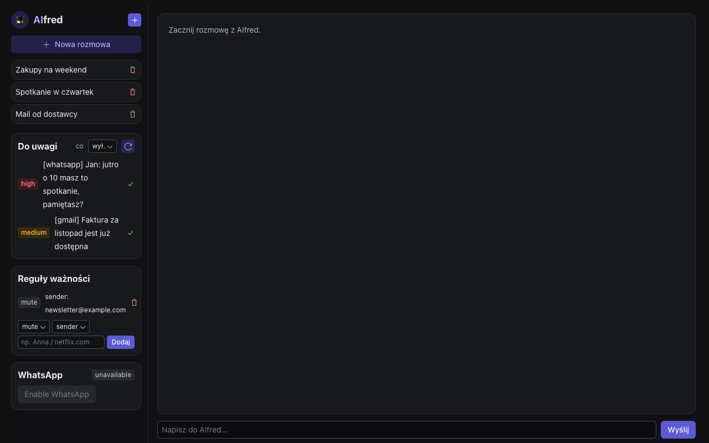

# AIfred

[](https://github.com/mi4uu/AIfred/actions/workflows/ci.yml)

A self-hosted personal assistant that runs on a local model and watches your WhatsApp, Gmail, Calendar, and Telegram so you don't have to check them yourself.

AIfred is the agent. [brain.md](https://github.com/mi4uu/brain.md) is its memory: a local-first Markdown vault with a built-in MCP server. AIfred reads and writes your notes, journal, and contacts through that server, so your data lives in files you can open and edit yourself, not in a database only AIfred understands. You need a running brain.md instance to use AIfred; the two are separate projects built to work together.

Everything runs on your own machine. The model is local (Ollama), the data stays local, and cloud fallback is off until you turn it on.

## What it does in practice

- Reads Gmail and manages your calendar. Mail access is read-only by default, and every calendar event it creates cites the note or message it came from.
- Watches WhatsApp, works out who's who from your Google contacts and brain.md, and learns that different people call you different things.
- Triages mail and messages in the background and pushes only what needs you to Telegram. One-time codes, newsletters, and phishing-shaped mail are filtered out by code, never left to the model to judge.
- Proposes calendar events from notes ("dentist on the 9th at 16:40") over Telegram with Yes/No buttons. Nothing lands on your calendar without a tap.
- Captures messages you send to yourself on WhatsApp into brain.md instead of dropping them.
- Answers questions about your own history ("what did Kasia ask me to buy last week") using a small retrieval layer over your past conversations, mail, and notes.
- Learns from correction: mute a sender, mark someone important, teach it a nickname, and it remembers.

You talk to it through a web UI or Telegram; both go through the same agent loop.

## Screenshot



Seeded with placeholder data, no real accounts connected. Run `uv run python docs/demo_seed.py` to reproduce it locally.

## Requirements

- [Ollama](https://ollama.com) with the models you want: `qwen3.6:27b` for the agent, and optionally `qwen3-vl:8b-instruct-q8_0` for vision and `qwen3-embedding:0.6b` for memory.
- A running [brain.md](https://github.com/mi4uu/brain.md) instance and an API key.
- Python 3.11 or later and [uv](https://docs.astral.sh/uv/).
- [Bun](https://bun.sh) to build the web UI. Skip it if you only want the API and Telegram.
- Optional: Google OAuth credentials (Gmail read, Calendar, Drive read, Contacts), a Telegram bot token, a WhatsApp account to pair.

## Quickstart

```bash
uv sync
cp .env.example .env        # fill in the brain.md URL and key, plus any channels you want
uv run pytest                # sanity check

cd web && bun install && bun run build && cd ..   # builds web/dist, served by the backend

uv run aifred-service        # full assistant: agent, triage, Telegram, on http://127.0.0.1:9120
```

`uv run aifred-service` serves `web/dist` if it exists; it doesn't build it. The `bun run build` step is required the first time and after any frontend change, or you get the API with no UI.

There's also `uv run aifred`, a bare FastAPI entrypoint with no agent wired in: `/health` and `/config` work, `/api/chat` does not, and nothing runs in the background. It exists for serving the UI or probing the API shape without starting the full assistant; for actual use, run `aifred-service`.

Point Ollama at a 16k context window so prompts don't get silently truncated: set `OLLAMA_CONTEXT_LENGTH=16384` on the Ollama service, and `OLLAMA_MAX_LOADED_MODELS=2` if you use the memory embedder, so it never evicts the agent model.

To run it as an always-on service, use the systemd unit in `deploy/`:

```bash
systemctl --user enable --now aifred
```

AIfred binds to localhost. Put it behind a tunnel (Cloudflare or similar) to reach it from your phone. WhatsApp pairing happens in the web UI: it shows a QR code once, and the session persists after that.

## Configuration

All settings are environment variables, read from `.env`; see `.env.example` for the full list. Secrets stay there and never touch the code, the spec, or the logs.

| Variable | What it's for |
|---|---|
| `AIFRED_MODEL` | Agent model, default `qwen3.6:27b` |
| `AIFRED_BRAINMD_MCP_URL`, `MCP_BRAIN_MD_API_KEY` | Your brain.md instance |
| `AIFRED_GOOGLE_TOKEN_PATH`, `AIFRED_GOOGLE_CLIENT_SECRET_PATH` | Gmail, Calendar, Drive, Contacts |
| `AIFRED_TELEGRAM_BOT_TOKEN`, `AIFRED_TELEGRAM_ALLOWED_USERS` | Telegram channel: push and chat |
| `AIFRED_WHATSAPP_ENABLED` | Turns WhatsApp on; pair from the web UI |
| `AIFRED_VISION_MODEL`, `AIFRED_EMBED_MODEL` | On-demand vision and the memory embedder |
| `AIFRED_WEB_TOKEN` | If set, required as the `X-AIfred-Token` header on every `/api/*` call |

Every channel is optional. With only brain.md configured, AIfred still runs as a notes-and-chat assistant and tells you which subsystems are off.

## How it uses brain.md

brain.md is the single source of truth for anything worth keeping: journal entries, the daily note, people, tasks. AIfred reads it through brain.md's own retrieval, so the model sees relevant chunks, not whole files, and re-reads your contacts each cycle so a number or nickname you add by hand (or another tool adds) shows up without a restart.

Run brain.md on its own if you only want the memory. Run AIfred if you want the assistant too; it needs brain.md either way.

## Safety model

What AIfred can do on its own: read Gmail (read-only, no send scope requested or implemented) and WhatsApp, read brain.md notes and journal entries, write brain.md self-notes it captures from you, and reply to you on Telegram or WhatsApp when you talk to it there, the same as the web UI.

What needs your confirmation first: every calendar write (`calendar_create`/`calendar_update`), whether you asked for it directly in chat or AIfred proposed it from a note. Chat-driven writes stage a pending confirmation in the web UI (`/api/confirm`); proposals from notes go out as a Telegram prompt with Yes/No buttons and the reason AIfred proposed them. Either way, nothing lands on your calendar until you approve it, and approving executes that exact pending action rather than quietly trusting the model to retry it.

AIfred does not send mail (no send scope exists) and has no tool to message a third party on WhatsApp on your behalf. It does reply directly on WhatsApp when you address it by name in a chat you're in (same trust boundary as talking to it on Telegram or the web), with no extra confirmation step for that reply, since it's answering you, not acting on someone else.

Cloud fallback (`AIFRED_CLOUD_FALLBACK_ENABLED`) is off by default; the model, your mail, and your WhatsApp history stay on your machine unless you turn it on. That's separate from Telegram itself: if you use the Telegram channel at all, your messages and AIfred's replies there necessarily pass through Telegram's own servers, not just your machine. Telegram access is gated to an allowed-users list.

### Safety guarantees

Three properties the confirm/execute path is built to hold, each backed by tests that simulate the failure directly rather than just exercising the happy path:

- **A pending confirmation expires.** An "ask" prompt (`ConfirmManager`, `aifred/confirm.py`) stops being approvable after `AIFRED_CONFIRM_TTL_SECONDS` (default 15 min); approving an expired token raises `ConfirmExpiredError` and the action never runs. See `tests/test_confirm.py::test_approving_an_expired_confirmation_is_refused_and_never_runs`, `::test_expired_confirmations_are_cleaned_up_and_reported`.
- **A crash never duplicates or drops an approved action.** Every side-effecting call runs through a durable action journal (`aifred/action_journal.py`, backed by the same sqlite `Store`): intent is recorded before the call, completion after. If AIfred dies in between, restart retries that one entry exactly once; the external system is expected to dedupe on the idempotency key it's handed (`merge_key_if_supported`), so the retry doesn't create a second real side effect. See `tests/test_action_journal.py::test_crash_after_side_effect_before_marked_done_does_not_duplicate_on_restart` and `::test_crash_before_execution_is_retried_not_lost_on_restart`.
- **A denied cross-user/cross-folder access attempt is refused, not worked around.** Enforced at the memory layer by [brain.md](https://github.com/mi4uu/brain.md), which this project depends on for storage of notes, journal, and contacts; see that project's own tests.

## Development

```bash
uv run pytest           # tests
uv run ruff check .     # lint
uv run mypy aifred      # types
```

CI runs all three on Python 3.11 and 3.12, on push to `main` and on every pull request.

Design notes, constraints, and the full list of invariants live in [SPEC.md](SPEC.md), written in a compact spec format.

## Status

AIfred works and is in daily use, but it's young and shaped around one person's setup, so expect rough edges. The eval harness (`uv run python -m aifred.eval.run`) and the invariants in `SPEC.md` are what keep it honest as it changes.

Issues and contributions are welcome. If you already run brain.md and a local model, it might save you some time too.

## Support

If this project saves you time, you can buy me a coffee:

[](https://github.com/sponsors/mi4uu)
[](https://www.paypal.com/paypalme/mi4uuuu)

## License

AGPL-3.0-or-later, matching brain.md, see [LICENSE](LICENSE).

Need it in a closed-source product, or can't meet the AGPL terms? Commercial licences are available on request: get in touch via [lipinski.work](https://lipinski.work).

By sending a pull request you agree that your contribution may be offered under both the AGPL and a commercial licence.

## Author

Made by [Michał Lipiński](https://lipinski.work) ([GitHub](https://github.com/mi4uu)).
